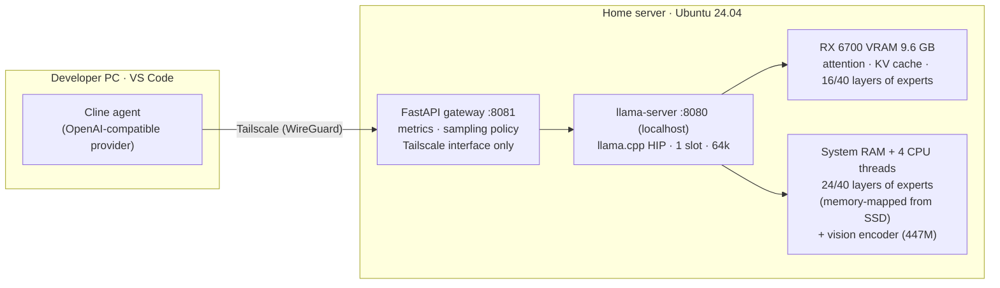

# Local LLM Coding Server: a 36B coding agent on a 10 GB AMD GPU

**A private, self-hosted AI coding assistant on budget hardware.** Qwen3.6-35B-A3B (36B parameters, free, Apache-2.0) runs on a **Radeon RX 6700 with 10 GB of VRAM** (a GPU AMD's ROCm doesn't officially support) plus 16 GB of RAM, serves **64k context at ~17 tokens/s**, **understands images** (screenshots, diagrams), and powers the **Cline** coding agent in VS Code from anywhere over a private Tailscale network. No subscription, and the code never leaves the owner's machines.


-ED1C24?logo=amd&logoColor=white)
-ED1C24)


<picture>
  <source media="(prefers-color-scheme: dark)" srcset="plots/speed_journey-dark.png">
  
</picture>

## Results at a glance

| | |
|---|---|
| **Model** | Qwen3.6-35B-A3B, UD-IQ4_XS GGUF (17.7 GB), mixture-of-experts, ~3B active parameters per token |
| **Context** | **64k tokens**, KV cache q8_0 |
| **Speed** | ~17 tok/s generation · 440–475 tok/s prompt processing · **median 2.2 s to first token** in real Cline use |
| **Coding quality (measured here)** | HumanEval+ **87.2** · MBPP+ **77.5** · **18/20** hidden-test agent tasks |
| **Vision** | reads screenshots, charts and diagrams: 5/5 facts on a test image, character-exact code transcription from a 1080p screenshot (~20–75 s per image, encoder on CPU) |
| **Long context** | 5/5 needle questions at 58k tokens · 16/16 correct across a 16-turn growing session |
| **Real usage** | 98 Cline agent requests, 87 tool calls, **0 errors** |
| **Hardware** | Ryzen 3 3200G (4 threads) · RX 6700 10 GB · 16 GB DDR4 (13.6 GiB usable) · SATA SSD |
| **Cost** | ~₹110–320/month electricity (estimate) vs ₹2,000/month for ChatGPT Plus or Claude Pro |
| **Occupancy** | single user at a time (by design, see [06](docs/06-serving-gateway.md)) |

<picture>
  <source media="(prefers-color-scheme: dark)" srcset="plots/bakeoff-dark.png">
  
</picture>

## Architecture



**The core idea:** a mixture-of-experts model only uses ~8 of its 256 experts per layer for each token. Everything every token needs (attention, KV cache, router) stays on the GPU. Most of the expert weights live in system RAM and are computed by the CPU. With the right flags (`--n-cpu-moe 24 --no-host --no-repack --cache-ram 0`, q8_0 KV), a 36B model fits a 10 GB card. The details, and every flag that *didn't* work, are in [docs/04-memory-engineering](docs/04-memory-engineering.md).

## How it was built

Dated from file timestamps and logs on the server.

| When | Milestone |
|---|---|
| Dec 2025 – Feb 2026 | Server built (Ubuntu). First ROCm attempts: ROCm 5.6 via `amdgpu-install`, `HSA_OVERRIDE_GFX_VERSION=10.3.0` to impersonate a supported GPU, PyTorch venv, image generation (ComfyUI, Fooocus) |
| Aug 2026 | **Native `gfx1031`**: TheRock ROCm 7.14 + llama.cpp built for `gfx1031`; HIP validation PASS; Qwen2.5-3B at ~98 tok/s |
| Aug – Sep 2026 | First coding-agent attempts: Qwen3-Coder-30B-A3B at **~0.5–1 tok/s** (layer split + KV in RAM), 1k/4k-token prompt benchmarks |
| Oct 4, 2026 | Qwen2.5-Coder-7B served to Cline over Tailscale; systematic evaluation starts |
| Oct 4–5, 2026 | 7B evaluation: quantization, 5 KV-cache configs, KL divergence, lm-eval → **found that a 4-bit K cache breaks the model** |
| Oct 5, 2026 | Fixed the 30B (MoE expert offload) → 15–19 tok/s; scanned 27 free models; **4-model bake-off** → Qwen3.6-35B-A3B wins |
| Oct 6, 2026 | Long-context tests (32k/64k pass, 128k hangs the driver → VRAM guard); gateway + Tailscale + Cline in daily use |
| Oct 7, 2026 | Old ROCm 5.6 stack removed, ~100 GB reclaimed; this repo |
| Oct 8, 2026 | **Vision enabled**: Qwen3.6's 447M vision encoder on the CPU (no VRAM cost), image tokens capped at 1,024 |

## Documentation

| # | Doc | What's inside |
|---|---|---|
| 01 | [Hardware](docs/01-hardware.md) | verified specs, memory budget, VRAM/RAM map |
| 02 | [GPU stack](docs/02-gpu-stack.md) | making the "unsupported" RX 6700 work: HSA override → TheRock + native gfx1031 build |
| 03 | [Model selection](docs/03-model-selection.md) | 27 free models screened, why architecture matters, bake-off |
| 04 | [Memory engineering](docs/04-memory-engineering.md) | 17 techniques: quantization, MoE offload, KV-cache policy, op offload, batching, the speed journey |
| 05 | [Long context](docs/05-long-context.md) | needle-in-codebase tests, prompt-cache reuse, the 128k driver hang |
| 06 | [Serving & gateway](docs/06-serving-gateway.md) | FastAPI gateway, metrics from a real Cline session, operations |
| 07 | [Networking](docs/07-networking-tailscale.md) | private access with Tailscale, security model |
| 08 | [Cline setup](docs/08-cline-setup.md) | install, exact settings, daily workflow, thinking mode |
| 09 | [Failures & lessons](docs/09-failures-and-lessons.md) | 15 postmortems with root causes |
| 10 | [Roadmap](docs/10-roadmap.md) | status against the project brief; next milestones |
| 11 | [Cost & comparison](docs/11-cost-and-comparison.md) | SWE-bench landscape vs paid models, electricity cost, honest trade-offs |
| 12 | [Future scope](docs/12-future-scope.md) | thinking models, image generation, speech, embeddings, speculative decoding, diffusion LLMs; model router + VRAM scheduler |
| 13 | [Model card](docs/13-model-card.md) | Qwen3.6-35B-A3B: architecture, vision encoder, files + SHA-256, quantization, scores, sampling |
| 14 | [Vision](docs/14-vision.md) | image understanding: how it works, **why it runs on the CPU**, configuration, measured speed and accuracy |
| — | [Benchmarks](benchmarks/README.md) | harness, suites, reproduction steps, raw results |
| — | [Environment](docs/environment.txt) | output of `tools/collect_env.sh` |
| — | [SETUP (one page)](docs/SETUP.md) | the short start/stop + Cline cheat sheet |

## Quick start (on similar hardware)

```bash
# 1. GPU stack: TheRock ROCm for gfx103X + llama.cpp built for your gfx target   → docs/02
# 2. Model
huggingface-cli download unsloth/Qwen3.6-35B-A3B-GGUF Qwen3.6-35B-A3B-UD-IQ4_XS.gguf --local-dir ~/models/gguf
# 3. Serve (preflight, VRAM guard, sanity check, gateway)
server/prod_server.sh start
# 4. Point Cline at http://<server>:8081/v1, model qwen3.6-35b-a3b, context 65536   → docs/08
```

## How to use

### Server (Linux, RX 6700): start, check, stop the model
Model: `~/models/gguf/Qwen3.6-35B-A3B-UD-IQ4_XS.gguf`

```bash
cd /data/projects/llm-serving/scripts     # on the server (server/ in this repo)
./prod_server.sh start         # thinking off (default)
./prod_server.sh start think   # thinking on (4096-token budget)
./prod_server.sh status        # running? VRAM, server + gateway health
./prod_server.sh stop          # stop the model and gateway, free the GPU

VISION=0 ./prod_server.sh start          # text only (vision is on by default)
IMG_TOKENS=2048 ./prod_server.sh start   # sharper images, ~2x slower per image
```

It's ready when you see `READY … sanity=391` and `gateway … health 200` (~1–2 min while the model loads).
Running `start` when the model is already up just prints `Already running and healthy`.

- llama-server: `127.0.0.1:8080` (private, localhost only)
- Gateway for Cline: `<TAILSCALE_IP>:8081` (Tailscale only; per-request metrics to `logs/gateway.jsonl`)
- After a reboot the model does **not** start by itself. Run `./prod_server.sh start` once.

### Client (your PC)
1. Connect Tailscale (same account as the server), then test:
   ```powershell
   curl.exe http://<TAILSCALE_IP>:8081/v1/models      # → qwen3.6-35b-a3b
   ```
2. Cline → ⚙️ → API Configuration:

   | Field | Value |
   |---|---|
   | API Provider | OpenAI Compatible |
   | Base URL | `http://<TAILSCALE_IP>:8081/v1` |
   | API Key | `local` |
   | Model ID | `qwen3.6-35b-a3b` |
   | Context Window | `65536` |
   | Max Output Tokens | `8192` |
   | Supports Images | **on** (vision: ~20 s small image, ~75 s full-HD screenshot) |
   | Temperature | default |

3. Enable **auto-compact** in Cline settings.
4. Work on a branch: `git checkout -b cline-work`.

### Rules
- **Context max is 64k.** Don't raise it: 128k hung the GPU driver.
- First prompt in a session: ~1–2 min. Later turns: ~5–10 s.
- **Never use a 4-bit K cache** (`-ctk q4_0`), because it breaks the model.
- If anything is stuck: `./prod_server.sh stop`, then `./prod_server.sh start`.
- If `stop` hangs or the GPU won't free memory: `sudo reboot`.
- One user at a time (single-occupancy server).

## Repository layout
```
docs/          14 chapters + SETUP.md + environment.txt
server/        prod_server.sh (launcher), gateway.py (FastAPI), serve.sh, sandbox.sh, common.sh
benchmarks/    scripts/, tasks/ (20 agent tasks), results/ (raw data), Dockerfile.sandbox
gpu-bringup/   the-rock-env.sh, hip_validation.cpp, vector_add.cpp
plots/         charts (light + dark), generated by tools/make_plots.py
tools/         make_plots.py, collect_env.sh
assets/        screenshots & media (see assets/README.md)
```

## What's next

Planned versions add **thinking models, image generation (Sana, SDXL, Z-Image, FLUX.1-schnell, Qwen-Image), speech (Whisper, Kokoro, Qwen3-TTS), embeddings + reranking for repo-wide search, and speculative decoding**. All are free models. With one 10 GB GPU, that requires a model router and VRAM scheduler in the gateway. See [docs/12-future-scope](docs/12-future-scope.md).

## Limitations
- **One user at a time.** A second concurrent user destroys the first one's prompt cache.
- **64k context.** 128k hung the amdgpu driver at 100% VRAM; it needs more RAM or a different split.
- **The first prompt of a big task takes 1–2 minutes** (prefill ~450 tok/s); later turns take seconds.
- **Paid frontier models are stronger on hard tasks.** Published scores are compared in [11](docs/11-cost-and-comparison.md). We have not run SWE-bench locally.
- **Speed depends on CPU and RAM bandwidth**, because the CPU computes 24 layers of experts.

## Acknowledgements
[llama.cpp](https://github.com/ggml-org/llama.cpp) · [ROCm / TheRock](https://github.com/ROCm/TheRock) · [Qwen](https://huggingface.co/Qwen) · [Unsloth GGUFs](https://huggingface.co/unsloth) · [Cline](https://github.com/cline/cline) · [Tailscale](https://tailscale.com) · [EvalPlus](https://github.com/evalplus/evalplus) · [lm-evaluation-harness](https://github.com/EleutherAI/lm-evaluation-harness) · [SWE-bench](https://www.swebench.com)

## License
MIT. See [LICENSE](LICENSE). Model weights keep their own licenses (Qwen3.6: Apache-2.0).
