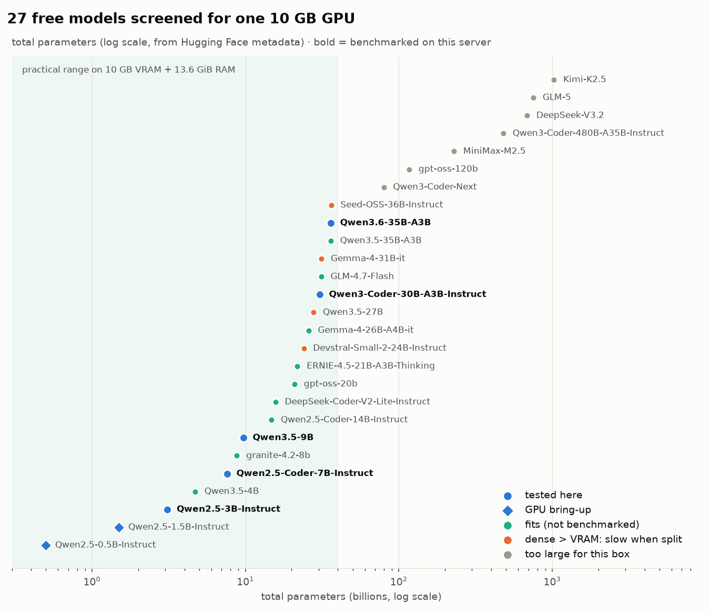
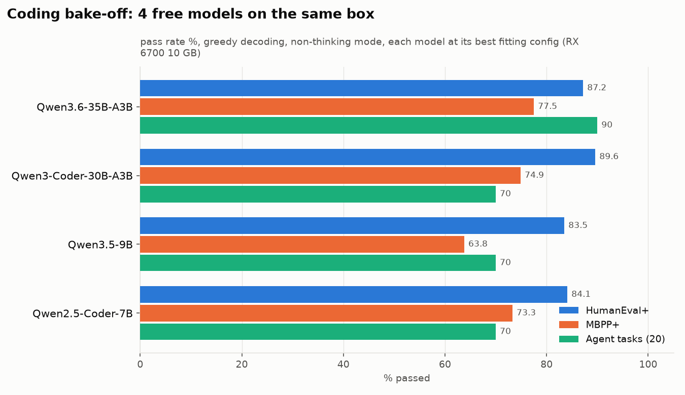

# 03 · Model selection: from 27 candidates to one

## Rules
1. **Free / open-weight only:** Apache-2.0, MIT, or the vendor's free license. No API keys, no subscriptions.
2. **Must fit:** 10 GB VRAM + 13.6 GiB RAM + a ~6.8 GiB GPU-mapped-RAM cap.
3. **Must be useful as a coding agent:** tool use, instruction following, long context, not just autocomplete.

## The candidate map

<picture>
  <source media="(prefers-color-scheme: dark)" srcset="../plots/model_fit-dark.png">
  
</picture>

Full table with sources: [`benchmarks/results/model_catalog.json`](../benchmarks/results/model_catalog.json). Parameter counts come from Hugging Face safetensors metadata, fetched 2026-10-07.

| Status | Models |
|---|---|
| **Benchmarked on this server** | Qwen2.5-3B, Qwen2.5-Coder-7B, Qwen3.5-9B, Qwen3-Coder-30B-A3B, **Qwen3.6-35B-A3B** |
| GPU bring-up (PyTorch/Transformers) | Qwen2.5-0.5B, Qwen2.5-1.5B |
| Fits, not benchmarked | Qwen3.5-4B, granite-4.2-8b, Qwen2.5-Coder-14B, DeepSeek-Coder-V2-Lite, gpt-oss-20b, ERNIE-4.5-21B-A3B, Gemma-4-26B-A4B, GLM-4.7-Flash, Qwen3.5-35B-A3B |
| Dense and larger than VRAM (slow when split) | Devstral-Small-2-24B, Qwen3.5-27B, Gemma-4-31B, Seed-OSS-36B |
| Free but far too large for this box | Qwen3-Coder-Next (80B), gpt-oss-120b, MiniMax-M2.5 (229B), Qwen3-Coder-480B, DeepSeek-V3.2 (685B), GLM-5 (754B), Kimi-K2.5 (1T) |

## Why architecture mattered more than parameter count

What decides fit on this box is the KV-cache cost per token of context and how much of the model is active per token, not just total size:

| Model | Attention layout | KV cache per token (q8_0) | 128k context KV |
|---|---|---|---|
| Qwen3-Coder-30B-A3B | 48 full-attention layers | ~52 KB | ~6.4 GiB, impossible here |
| **Qwen3.6-35B-A3B** | **10 full + 30 linear (Gated DeltaNet) layers** | **~11 KB** | **~1.3 GiB** |
| gpt-oss-20b | 12 full + 12 sliding-window (128) | ~12 KB | ~1.5 GiB |
| Qwen3.5-9B | 8 full + 24 linear | ~17 KB | ~2.1 GiB |

- **Dense models above ~14B** must be split across GPU and CPU. Every weight is read for every token, so speed collapses to a few tokens/s.
- **Mixture-of-experts (MoE) models** activate only ~3B of their 30–36B parameters per token, so the inactive experts can live in system RAM.
- **Hybrid linear attention** (Qwen3.5/3.6) keeps the KV cache tiny, which is what makes 64k context possible here.

## Bake-off (same harness, same box)

<picture>
  <source media="(prefers-color-scheme: dark)" srcset="../plots/bakeoff-dark.png">
  
</picture>

| Model | Quant | Config on this box | HumanEval / + | MBPP / + | Agent tasks | Context | Gen speed |
|---|---|---|---|---|---|---|---|
| Qwen2.5-Coder-7B | Q4_K_M | full GPU | 89.0 / 84.1 | 83.6 / 73.3 | 14/20 | 64k | ~50 t/s |
| Qwen3.5-9B | Q4_K_M | full GPU | 87.2 / 83.5 | 77.2 / 63.8 | 14/20 | 64k | fast |
| Qwen3-Coder-30B-A3B | Q4_K_S | experts of 30/48 layers on CPU | **93.9 / 89.6** | 88.1 / 74.9 | 14/20 | **32k max** | ~15 t/s |
| **Qwen3.6-35B-A3B** | **UD-IQ4_XS** | **experts of 24/40 layers on CPU** | 91.5 / 87.2 | **91.8 / 77.5** | **18/20** | **64k** | **~17 t/s** |

- **HumanEval+ / MBPP+** ([EvalPlus](https://github.com/evalplus/evalplus)): 164 + 378 Python problems with extra hidden tests. Greedy decoding, non-thinking mode, generated code executed in a **network-isolated Docker sandbox**.
- **Agent tasks:** 20 custom repo tasks, scored by **hidden pytest tests** the model never sees: 7 bug fixes, 3 features, 5 implement-from-spec, 2 performance, 2 multi-file refactors, 1 write-tests task (scored by mutation testing). Each task was validated before use: the original code fails its tests and the reference solution passes. See [`benchmarks/tasks/build_tasks.py`](../benchmarks/tasks/build_tasks.py).

**Why Qwen3.6-35B-A3B won:** it passed every bug fix and feature task, where the 30B coder skipped stated requirements (and once claimed a fix it hadn't made). It got the best MBPP+, and it is the only strong model that runs **64k context without a hardware upgrade**.

## The 7B baseline in depth

Before the bake-off, Qwen2.5-Coder-7B was used to validate the whole harness against published numbers:

| | HumanEval | HumanEval+ | MBPP | MBPP+ |
|---|---|---|---|---|
| Published (Qwen report, BF16) | 88.4 | 84.1 | 83.5 | 71.7 |
| Q4_K_M on this box | 89.0 | 84.1 | 83.6 | 73.3 |
| Q8_0 on this box | 90.2 | 85.4 | 84.4 | 73.5 |

| General ability (lm-eval) | Q4_K_M | Q8_0 |
|---|---|---|
| GSM8K (250 questions, 8-shot CoT) | 79.6 ± 2.6 | 78.4 ± 2.6 |
| IFEval (541 prompts, prompt-level strict) | 58.2 ± 2.1 | 58.6 ± 2.1 |
| MMLU-Pro (140 questions, 5-shot CoT) | 38.6 ± 4.0 | 40.0 ± 3.9 |

Conclusions: 4-bit weights cost nothing measurable on coding; instruction following (IFEval 58%) is the 7B's real weakness for agent work.
