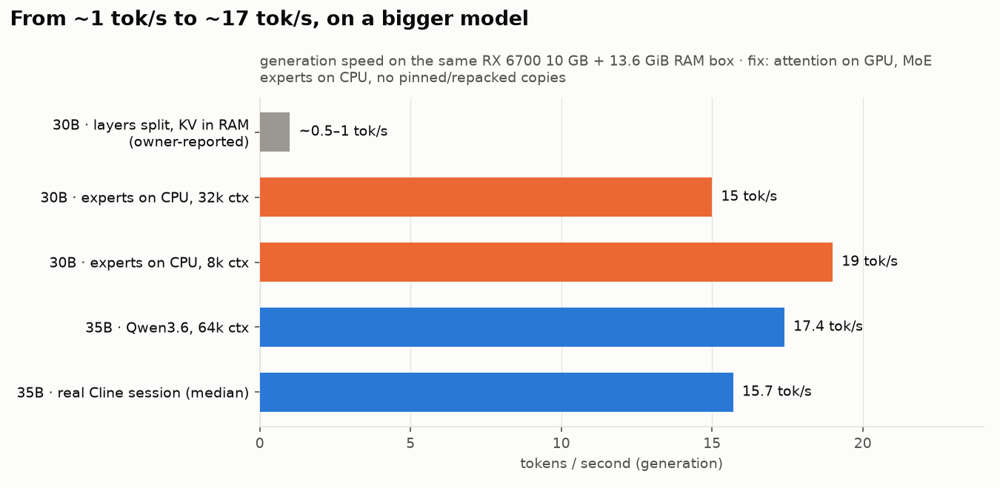
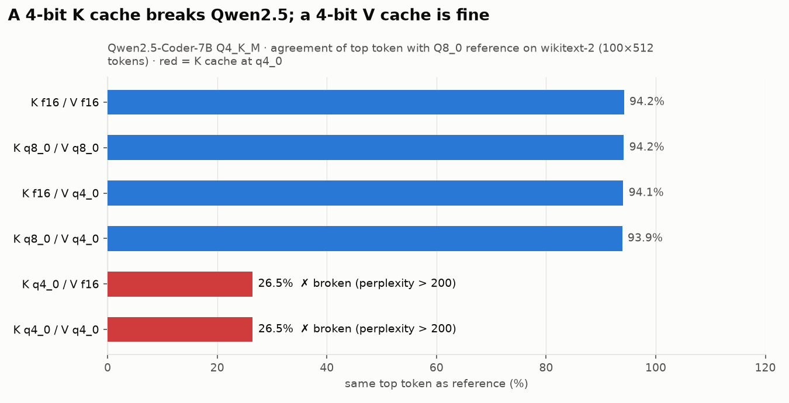
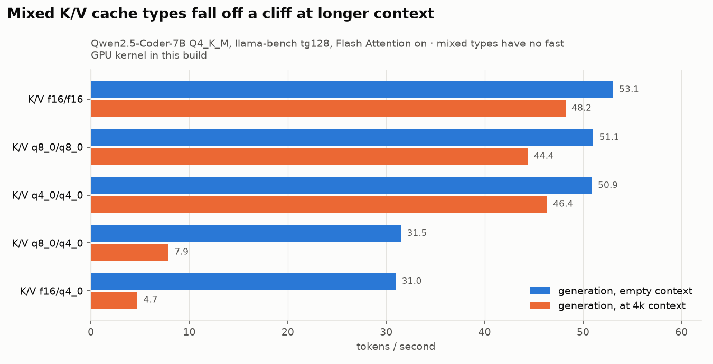

# 04 · Memory engineering: fitting 36B parameters into 10 GB of VRAM

Every technique below was tried on this machine. Each comes with what it does, the flag, the measured effect, and the failure it caused or fixed.

## The speed journey: from ~1 tok/s to ~17 tok/s on a bigger model

<picture>
  <source media="(prefers-color-scheme: dark)" srcset="../plots/speed_journey-dark.png">
  
</picture>

| Stage | Model | Setup | Generation speed | Context |
|---|---|---|---|---|
| Before | Qwen3-Coder-30B-A3B | `-ngl 18–24 -nkvo`: whole layers *including attention* on the CPU, KV cache in RAM | **~0.5–1 tok/s** (owner-reported) | 32k attempted |
| Diagnosis | Qwen3-Coder-30B-A3B | all experts on CPU (15 GiB > RAM) | prefill 2.4 tok/s; generation never finished (SSD thrash, then a ROCm error) | — |
| Fix | Qwen3-Coder-30B-A3B | `-ngl 99 --n-cpu-moe 30 --no-host --no-repack`, op offload, ub 2048 | **15–19 tok/s**, prefill 432 tok/s | 32k |
| Upgrade | **Qwen3.6-35B-A3B** | `--n-cpu-moe 24`, hybrid attention, q8_0 KV | **~17 tok/s** (median 15.7 in real Cline use) | **64k** |

A **bigger model** (36B vs 30B parameters) ended up **faster and with double the context** on the same hardware. That came from understanding where each tensor should live, not from buying anything.

## Techniques at a glance

| # | Technique | llama.cpp flag(s) | Verdict on this box |
|---|---|---|---|
| 1 | Weight quantization | GGUF `Q8_0`, `Q4_K_M`, `Q4_K_S`, `UD-IQ4_XS` | ✅ 4-bit ≈ lossless for coding (KLD 0.013 vs Q8_0) |
| 2 | Full GPU offload | `-ngl 99` | ✅ for ≤ 9B models |
| 3 | Partial layer offload | `-ngl 18…24` | ❌ ~1 tok/s on the 30B MoE (attention moved to CPU too) |
| 4 | KV cache in system RAM | `-nkvo` | ❌ slow; part of the 1 tok/s config |
| 5 | **MoE expert offload** (attention on GPU, experts on CPU) | `--n-cpu-moe N` / `-ot exps=CPU` | ✅ **the key technique**: 10–19 tok/s |
| 6 | Keep CPU weights memory-mapped, no copies | `--no-repack` | ✅ required: repacking duplicated 8+ GB, causing swap |
| 7 | No pinned host buffers | `--no-host` | ✅ required: pinned memory exceeded the amdgpu mapping cap → crash |
| 8 | Op offload (stream CPU experts to GPU for large batches) | default on (`--no-op-offload` to disable) | ✅ keep on: prefill 183 vs 52 tok/s |
| 9 | Batch / micro-batch size | `-b 2048 -ub 2048` (`-ub 1024` at long ctx) | ✅ ub 2048 fastest; prefill reaches 432 tok/s on 20k prompts |
| 10 | Flash Attention | `-fa on` | ✅ +9% prefill, +5% decode (3B); required for quantized V cache |
| 11 | **KV-cache quantization** | `-ctk / -ctv` | ✅ q8_0/q8_0 · ❌ **K at q4_0 destroys Qwen** · ⚠ mixed K/V types 6× slower |
| 12 | Context length sweep | `-c 8k … 128k` | ✅ 64k stable · ❌ 128k hung the driver |
| 13 | Prompt (prefix) cache reuse | automatic per slot | ✅ only new tokens are processed per agent turn |
| 14 | Host RAM prompt cache | `--cache-ram` (default 8192 MiB) | ❌ filled RAM and swap over hours → **set 0** |
| 15 | Swap on SSD | 4 GiB swap file | ⚠ a symptom, not a tool: when it fills, MoE weights get evicted and speed collapses |
| 16 | VRAM guard | (our launcher) refuse to serve if > 95% VRAM after load | ✅ prevents the 128k deadlock class |
| 17 | Thinking mode control | `--reasoning off` / `--reasoning-budget 4096` | ✅ off for speed; budgeted mode available |

## 1 · Weight quantization (Qwen2.5-Coder-7B, wikitext-2, 100×512 tokens)

| Weights | Perplexity | Mean KL divergence vs Q8_0 | Same top token |
|---|---|---|---|
| Q8_0 (reference) | 10.14 | — | — |
| Q4_K_M | 10.33 (+1.9%) | 0.013 | 94.2% |

HumanEval+ and MBPP+ moved by ≤ 1.3 points between Q8_0 and Q4_K_M, which is within noise. 4-bit weights are the right default.

## 5 · MoE expert offload: why it works

A 30–36B MoE model has ~128–256 experts per layer, but each token uses only **8** of them (~3B active parameters).
- **Attention, norms, router and embeddings** are small (~0.9 GiB for the 30B) and used by every token, so they go on the GPU.
- **Expert weights** are huge (15.3 GiB for the 30B) but each token touches only a few, so some layers' experts stay in RAM and the **CPU computes them**.

`--n-cpu-moe N` keeps the experts of the first N layers on the CPU. Finding N is a budget problem: the GPU must hold attention + KV cache + compute buffers + the remaining experts, and the CPU-side bytes must stay under RAM *and* the driver's mapping cap.

### Qwen3-Coder-30B-A3B probe (Q4_K_S, 16.25 GiB; experts 15.33 GiB = 0.32 GiB/layer)

| `--n-cpu-moe` | Context | VRAM | Prefill (prompt size) | Generation | Status |
|---|---|---|---|---|---|
| 48 (all experts on CPU) | — | — | 2.4 t/s | — | ❌ 15 GB of experts > RAM → thrash, then ROCm error |
| 26 | 8k | 9.1 GB | 183 t/s (1.4k) | 19 t/s | ✅ |
| **30** | **32k** | 9.1 GB | **432 t/s (20.5k)** | 15 → 10.5 t/s | ✅ stable |
| 32 | 48k | 9.1 GB | 243 t/s (41.9k) | 16 → 7.9 t/s | ⚠ works, 2,045 SVM warnings |
| 35 | 64k | — | — | — | ❌ GPU OOM + SVM cap |
| 37 | 64k | — | — | — | ❌ crash on a 3k prompt |

**Before:** your earlier `-ngl 18–24 -nkvo` attempts at ~1 tok/s. **After:** `-ngl 99 --n-cpu-moe 30 --no-host --no-repack` at 10–19 tok/s.

### Qwen3.6-35B-A3B (production, UD-IQ4_XS, 17.7 GB)
The smallest `--n-cpu-moe` that loads at 64k context was found by search (18 ✗, 21 ✗, **24 ✓**): 9.6 GB VRAM, server RSS ~10.5 GB, **zero** SVM warnings, 17 tok/s.

## 11 · KV-cache quantization: the most important finding

<picture>
  <source media="(prefers-color-scheme: dark)" srcset="../plots/kv_cache_quality-dark.png">
  
</picture>

| K / V cache | Perplexity | Mean KLD | Same top token | HumanEval+ | Agent tasks |
|---|---|---|---|---|---|
| f16 / f16 | 10.33 | 0.013 | 94.2% | 84.1 | 14/20 |
| **q8_0 / q8_0** | **10.34** | **0.014** | **94.2%** | **83.5** | **14/20** |
| q8_0 / q4_0 | 10.35 | 0.015 | 93.9% | 82.9 | 14/20 |
| f16 / q4_0 | 10.35 | 0.015 | 94.1% | — | — |
| q4_0 / f16 | **203.5** | 3.39 | 26.5% | — | — |
| **q4_0 / q4_0** | **205.6** | 3.40 | 26.5% | **0.0** | **0/20** |

- A **4-bit K cache destroys Qwen2.5**: the model answers "17×23?" with *"I'm sorry, but I don't know what"*, and llama-server returns **HTTP 500** when the chat parser can't read the garbled output.
- **It is not a ROCm bug:** it reproduces on the CPU backend and with Q8_0 weights (perplexity 190). Qwen's key vectors have outlier channels that 4 bits can't represent. The V cache is unaffected.
- This had been the owner's **production setting before this project**. A known-answer sanity check (`17×23 = 391`) at every server start now catches this class of failure.

<picture>
  <source media="(prefers-color-scheme: dark)" srcset="../plots/kv_cache_speed-dark.png">
  
</picture>

Mixed K/V types (e.g. q8_0/q4_0) are accurate but have no fast Flash Attention GPU kernel in this build: **7.9 tok/s at 4k context vs 44.4** for q8_0/q8_0. Hence **q8_0/q8_0**: same quality as f16, half the memory, near-identical speed.

## 14 · The `--cache-ram` trap

llama-server keeps old prompts' KV state in **host RAM, up to 8 GiB by default**. Over a 4-hour benchmark this grew the server from 9.2 to 12 GB of RAM, filled the 4 GiB swap, evicted the memory-mapped expert weights, and turned 50 s requests into >100 s timeouts. With `--cache-ram 0`, memory stayed flat for days. In-slot prefix reuse (what makes agent turns fast) **still works**.

## The production command

```bash
llama-server -m Qwen3.6-35B-A3B-UD-IQ4_XS.gguf --alias qwen3.6-35b-a3b \
  --host 127.0.0.1 --port 8080 -dev ROCm0 \
  -ngl 99 --n-cpu-moe 24 -fa on -c 65536 -np 1 -t 4 -b 2048 -ub 2048 \
  -ctk q8_0 -ctv q8_0 --no-host --no-repack --cache-ram 0 \
  --jinja --metrics --reasoning off \
  --temp 0.7 --top-p 0.8 --top-k 20 --min-p 0 --presence-penalty 1.5
```
Wrapped with preflight, VRAM guard and sanity check in [`server/prod_server.sh`](../server/prod_server.sh).
