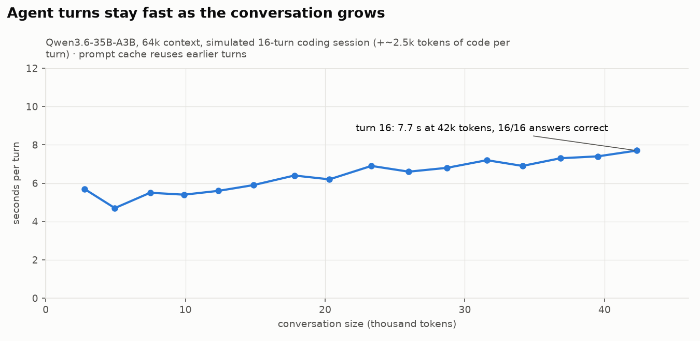

# 05 · Long context: 32k, 64k, and the 128k attempt

Model: Qwen3.6-35B-A3B UD-IQ4_XS, `--n-cpu-moe 24`, q8_0/q8_0 KV, thinking off, greedy.

## Test design (needle-in-a-codebase)
- **Haystack:** real C++ source from llama.cpp, padded to the target token count.
- **Needles:** synthetic functions with known return values planted at **10%, 50% and 90%** depth.
- **Two-hop:** a function at 5% depth calls one at 95% depth.
- **Trap:** a question about a function that **does not exist**; the only correct answer is `NOT FOUND`. This tests hallucination.
- **Session test:** 16 turns, each adding ~2.5k tokens of new code and a question, with every fourth turn asking about turn 1.

Script: [`benchmarks/scripts/longctx.py`](../benchmarks/scripts/longctx.py). Raw results: [`benchmarks/results/longctx/`](../benchmarks/results/longctx/).

## Results

| Context | VRAM after load | Prompt | Cold prefill | Follow-up question | Accuracy | Driver warnings |
|---|---|---|---|---|---|---|
| 32k (ub 2048) | 9.1 GB | 29.2k tokens | 62 s (474 tok/s) | ~4.5 s | 4/5 (two-hop wrong) | 0 |
| **64k** (ub 2048) | 9.6 GB | 57.8k tokens | 131 s (442 tok/s) | **~6 s** | **5/5** | 0 |
| **64k session** (16 turns → 42k) | 9.6 GB | +2.5k per turn | — | **5–8 s per turn** | **16/16** | 0 |
| 128k (ub 1024) | **10.2 / 10.2 GB** | ~120k tokens | **driver hang** | — | — | — |

<picture>
  <source media="(prefers-color-scheme: dark)" srcset="../plots/longctx_session-dark.png">
  
</picture>

**Prefix caching is what makes a local agent usable:** after the first (slow) turn, the server reuses the cached KV of the shared prefix and processes only the new tokens. In real Cline use the median turn processed **190 new tokens on top of 25.0k cached ones**.

## The 128k failure
At 128k the server loaded with VRAM essentially full. During the 120k-token prefill, the amdgpu driver deadlocked in its buffer eviction/restore path (`kfd_restore_wq → amdgpu_amdkfd_gpuvm_restore_process_bos`, then `svm_range_set_attr`). The process went into uninterruptible `D` state holding all VRAM, and only a reboot cleared it.

**Fix:** the production launcher now refuses to serve if VRAM after load exceeds 95%. 128k remains on the roadmap, needing more experts on the CPU and therefore more RAM.

## Practical guidance for Cline
- **Context window: 65536**, with auto-compact on.
- Cline's system prompt and tool definitions take ~10–15k tokens, leaving ~50k for your code and conversation.
- The first message of a new task costs ~1–2 min on a large repo; later turns take seconds.
