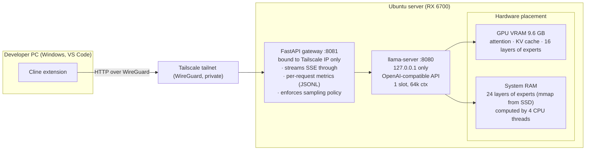
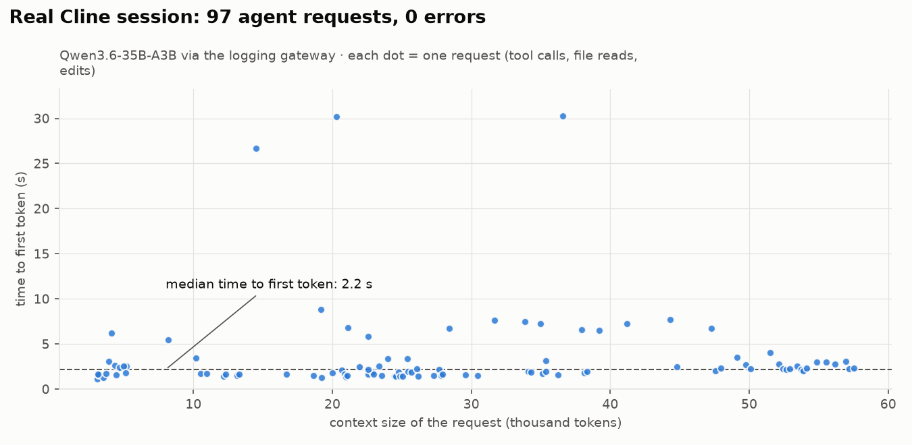

# 06 · Serving: llama-server + a FastAPI gateway



## Why a gateway?
llama-server already speaks the OpenAI API. The gateway ([`server/gateway.py`](../server/gateway.py), ~150 lines) adds what a serving system needs:

| Concern | How |
|---|---|
| **Observability** | One JSON line per request: context size, cached vs new tokens, prefill time, **time to first token**, generation tok/s, tool calls, finish reason, errors |
| **Network isolation** | llama-server listens on `127.0.0.1` only; the gateway listens only on the Tailscale interface |
| **Sampling policy** | Strips client sampling params so the server applies Qwen's recommended non-thinking settings (temp 0.7, top-p 0.8, top-k 20, presence 1.5). Cline's defaults (e.g. temperature 0) can't override them |
| **Streaming** | Server-sent events are passed through unchanged; metrics come from the final chunk's `timings` |

## Real usage: one Cline session

<picture>
  <source media="(prefers-color-scheme: dark)" srcset="../plots/cline_session-dark.png">
  
</picture>

From [`benchmarks/results/gateway/cline_session_metrics.jsonl`](../benchmarks/results/gateway/cline_session_metrics.jsonl) (prompt previews removed for privacy):

| Metric | Value |
|---|---|
| Agent requests | 98 (all streamed, over two days), **0 errors, 0 truncations** |
| Tool calls | 87 |
| Context per request | median ~25.4k, max **57.5k** tokens |
| Prompt cache | median **25.0k cached / 190 new** tokens per turn |
| Time to first token | **median 2.2 s**, p95 7.7 s |
| Full turn | median 11.4 s, p95 88 s (long outputs or cold prompts) |
| Generation speed | median **15.7 tok/s** |

## Operations
```bash
server/prod_server.sh start          # preflight → load → VRAM guard → sanity (17×23=391) → gateway
server/prod_server.sh start think    # thinking mode, 4096-token reasoning budget
server/prod_server.sh status
server/prod_server.sh stop
```
Preflight refuses to start if a llama process, a busy port, or used VRAM is detected. Two copies would deadlock the 10 GB card.

## Single-occupancy by design
One slot (`-np 1`): one active Cline session at a time. A second user would overwrite the first one's prompt cache, turning every turn into a 1–2 minute cold prefill for *both* users. Measuring multi-user behavior (bounded concurrency, backpressure, p95/p99) is the next milestone ([10-roadmap](10-roadmap.md)).
