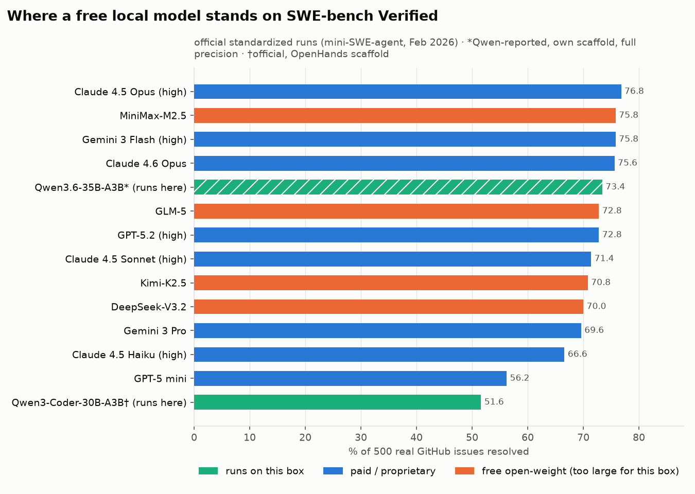

# 11 · How it compares with paid AI coding tools

## Benchmark landscape (published numbers)

<picture>
  <source media="(prefers-color-scheme: dark)" srcset="../plots/swe_bench_landscape-dark.png">
  
</picture>

**SWE-bench Verified:** 500 real GitHub issues; a model "resolves" one if its patch passes the project's tests.

- **Paid models and the large open models:** the official standardized runs (same minimal agent, one attempt, Feb 2026), from the [SWE-bench leaderboard data](https://github.com/SWE-bench/swe-bench.github.io).
- **Qwen3.6-35B-A3B (73.4):** reported by Qwen with its own agent scaffold, at full precision and 200K context. Not the same setup as the official runs.
- **Qwen3-Coder-30B-A3B (51.6):** official leaderboard entry, OpenHands scaffold.

**What this does and does not show:** the model this server runs is in the **same score band** as several paid frontier models on this benchmark. It does **not** mean this box matches them. Our copy is 4-bit quantized and limited to 64k context, and we have not run SWE-bench on it ourselves. Also note: SWE-bench Verified is public and partly memorized by recent models (OpenAI now recommends SWE-bench Pro instead).

## Cost per month (India)

| Option | Monthly cost |
|---|---|
| ChatGPT Plus | ₹1,999 ([source](https://www.croma.com/unboxed/openai-brings-chatgpt-local-pricing-to-india)) |
| Claude Pro | ₹2,000 ([source](https://www.outlookbusiness.com/deeptech/claude-pro-now-costs-2000-in-india-as-anthropic-localises-subscription-pricing)) |
| GitHub Copilot Pro | ~₹999 (USD-billed) |
| **This server, electricity only** | **~₹110–320** (estimate below) |

**Electricity estimate.** Measured: GPU averaged **37 W** while generating (peak 47 W) and **5 W** idle (`amd-smi`). Not measured (needs a wall meter): CPU (65 W TDP part, fully loaded while generating) and the rest of the system. Estimated whole-system draw: ~120 W while generating, ~40 W idle. At ₹8/kWh:
- 4 h of active use per day, server **off** otherwise: ~0.5 kWh/day → **~₹115/month**
- 4 h active + 20 h idle (always on): ~1.3 kWh/day → **~₹310/month**

The hardware was already owned, so it's treated here as a sunk cost.

## Honest trade-offs

| | Paid subscription | This local server |
|---|---|---|
| Raw capability on hard tasks | **Higher** (frontier models, 200k+ context) | Good: 18/20 agent tasks, HumanEval+ 87.2 |
| Speed | Fast, scales | ~15–17 tok/s; first big prompt ~1–2 min |
| Context | 200k+ | 64k |
| Users | Many | **One at a time** (single-occupancy) |
| Privacy | Code sent to a vendor | **Code never leaves your network** |
| Limits | Rate limits / quotas | None except hardware |
| Works offline | No | Yes (within the tailnet) |
| Ongoing cost | ₹1,000–2,000/month | Electricity |
| Setup effort | Minutes | This whole repo |
