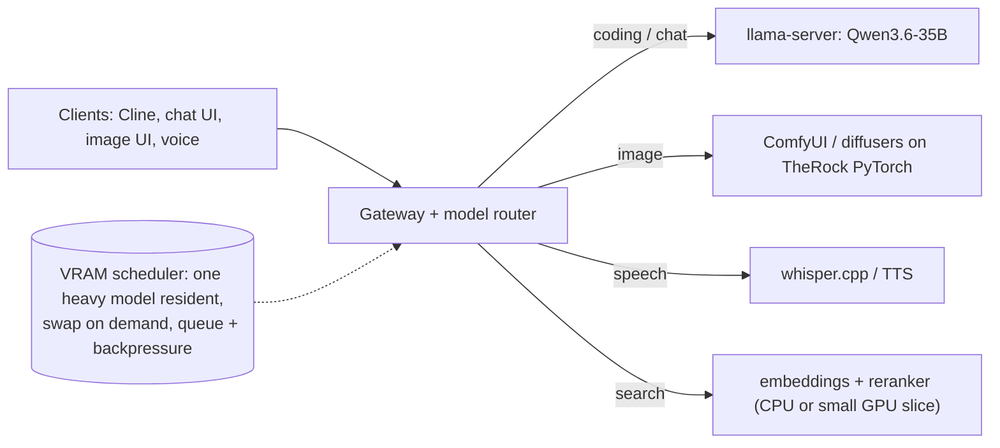

# 12 · Future scope: beyond one coding model

Version 1 serves one coding model. Later versions will add other model types. All candidates below are **free, open-weight** models; sizes and licenses come from Hugging Face metadata (fetched 2026-10-07). "Fit" is planned, not yet tested.

## The constraint that shapes everything

The RX 6700 has 10 GB of VRAM and the coding model already uses **9.6 GB**. Two large models cannot be resident at once, so multi-model serving here means **time-sharing the GPU**:

That turns "add more models" into the core serving problem of this project: **which model is resident, when to swap (a cold load costs ~1 min), how to queue requests, and how to keep small models (embeddings, speech) on the CPU** so they never evict the coding model.

## 1 · Thinking (reasoning) models
| Model | Size | License | Plan |
|---|---|---|---|
| **Qwen3.6-35B-A3B, thinking mode** | 36B MoE | Apache-2.0 | Already wired: `prod_server.sh start think` (4,096-token reasoning budget). Next: bake-off of thinking vs non-thinking on the agent tasks, weighing accuracy against latency (thinking tokens cost real seconds at ~17 tok/s) |
| DeepSeek-R1-0528-Qwen3-8B | 8.2B dense | MIT | Fully on GPU; fast reasoning model for math and logic |
| gpt-oss-20b (reasoning effort low/med/high) | 20.9B MoE | Apache-2.0 | Easy fit; adjustable reasoning depth |

Question to answer: at what reasoning budget does accuracy stop improving on this hardware, and what does each extra point cost in seconds?

## 2 · Image generation
Runtime: ComfyUI or diffusers on the **TheRock PyTorch wheels** (`torch 2.12.0+rocm7.14`, already working on gfx1031). This machine already ran ComfyUI and Fooocus in early 2026 through the HSA override; the plan is to redo it on the native stack.

| Model | Size | License | Expected fit on 10 GB |
|---|---|---|---|
| Sana 1600M | 1.6B | Apache-2.0 | ✅ comfortable (known to run on 8 GB cards) |
| Stable Diffusion XL base 1.0 | 2.6B | OpenRAIL++ | ✅ largest LoRA/ControlNet ecosystem |
| Stable Diffusion 3.5 Medium | 2.5B | Stability Community (free < $1M revenue) | ✅ |
| **Z-Image-Turbo** | 6.2B | Apache-2.0 | ⚠ needs 8-bit/GGUF weights (bf16 ≈ 12 GB) |
| **FLUX.1-schnell** | 11.9B | Apache-2.0 | ⚠ quantized (GGUF/FP8) + CPU offload of the text encoder |
| Qwen-Image | 20.4B | Apache-2.0 | ⚠ heavy quantization + offload; best text-in-image rendering |
| FLUX.2-dev | 32.2B | non-commercial | ❌ too large (needs ~13 GB+ even quantized); listed for reference |

Same lessons as the LLM work apply: quantization levels, CPU offload of text encoders and VAE, and measuring seconds per image and peak VRAM per configuration.

## 3 · Vision-language (images in, code or text out)
| Model | Size | License | Plan |
|---|---|---|---|
| **Qwen3.6-35B-A3B + vision projector** | +mmproj (858 MiB) | Apache-2.0 | ✅ **Done (Oct 8)**: projector on the CPU, no VRAM cost. See [14-vision](14-vision.md). Next: GPU placement trade-offs, a proper vision benchmark |
| Qwen3-VL-8B-Instruct | 8.8B | Apache-2.0 | Dedicated vision model |
| DeepSeek-OCR-2 | 3.4B | Apache-2.0 | Document and screenshot OCR |

## 4 · Speech
| Model | Size | License | Plan |
|---|---|---|---|
| Whisper large-v3-turbo | 0.8B | MIT | Speech-to-text (whisper.cpp has a HIP backend; CPU also viable) |
| Kokoro-82M | 82M | Apache-2.0 | Fast text-to-speech on CPU |
| Qwen3-TTS (0.6B / 1.7B) | 0.6–1.7B | — | The local llama.cpp build already includes a `qwen3tts` architecture |

Goal: a voice loop (talk to the coding agent) without touching the GPU budget of the main model.

## 5 · Embeddings + reranking (codebase search beyond 64k)
| Model | Size | License |
|---|---|---|
| Qwen3-Embedding-0.6B | 0.6B | Apache-2.0 |
| Qwen3-Reranker-0.6B | 0.6B | Apache-2.0 |
| BGE-M3 | ~0.6B | MIT |

A repo-wide retrieval index lets the agent pull just the relevant files into the 64k window, instead of growing the window. These run fine on the CPU.

## 6 · Fast code completion (fill-in-the-middle)
Qwen2.5-Coder-1.5B (Apache-2.0) as an inline tab-completion model next to the Cline agent. Completion needs latency in milliseconds, not quality at 36B.

## 7 · Speed-ups: speculative decoding
A small draft model (or an EAGLE/DFlash-style draft head) proposes tokens that the 35B verifies in one pass. llama.cpp supports draft models (`--spec-draft-*` flags in this build). Worth measuring because decoding is CPU-bound on this box.

## 8 · New model classes to track
| Model | Size | License | Why |
|---|---|---|---|
| LLaDA2.2-mini | 16.3B | Apache-2.0 | **Diffusion language model**: generates tokens in parallel instead of one at a time |
| Stable-DiffCoder-8B-Instruct | 8.3B | MIT | Diffusion-based **code** model |
| Wan2.2-TI2V-5B | ~5B | Apache-2.0 | Text/image-to-video; a stretch goal on 10 GB |

## 9 · Bigger language models (needs hardware changes)
Dense models such as **Qwen3.6-27B** (27.8B, Apache-2.0) and 128k context for the current model need either more system RAM (32 GB would remove most limits found here) or a GPU with more VRAM.

## Version plan

| Version | Scope |
|---|---|
| **v1 (this repo)** | One coding model, 64k, gateway, Cline, full benchmark suite, **vision input (done)** |
| v1.1 | systemd service, load test (p50/p95/p99), backpressure, failure injection, Ollama comparison |
| v2 | Thinking-mode bake-off; vision benchmark; embeddings + reranker for repo search |
| v3 | Model router with VRAM scheduler; image generation (Sana/SDXL → Z-Image/FLUX.1-schnell) |
| v4 | Speech loop (Whisper + TTS); speculative decoding; diffusion LLM experiments |
