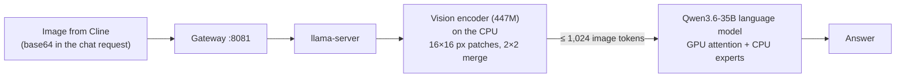

# 14 · Feature: image understanding (vision)

The server can **read images**: screenshots of errors, UI bugs, diagrams, charts, photos of whiteboards. Cline sends them along with the task, and the model answers about what it sees.

## How it works

Qwen3.6-35B-A3B is natively multimodal. In llama.cpp, the vision part lives in a separate file, the **multimodal projector** (`mmproj-F16.gguf`, a 447M-parameter vision encoder plus a projector):



## Why it runs on the CPU

| | Value |
|---|---|
| VRAM used by the coding model at 64k context | **~9.6 GB of 10.2 GB** |
| Free VRAM | **~530 MiB** |
| Vision projector size | **858 MiB** |
| VRAM safety limit | **95%**, added after 100% VRAM deadlocked the amdgpu driver ([05](05-long-context.md)) |

The projector **does not fit** in the remaining VRAM. Forcing it onto the GPU would push usage past the safety limit and risk the same driver hang. So it runs with `--no-mmproj-offload`:
- ✅ **zero VRAM cost**: the coding model's 64k context and speed are unchanged
- ✅ ~0.9 GB extra system RAM (fine: ~10.7 GB still available)
- ⚠ images are encoded by the 4-thread CPU, so each image takes seconds to a minute

**Alternative (not used):** move 2–3 more layers of experts to the CPU (`--n-cpu-moe 26–27`) to free VRAM for the projector. Images would be faster, but every text token would get slower, and CPU-side memory would approach the limits found with the 30B model. Image encoding happens once per image, while text generation happens on every token, so the CPU placement is the better trade.

## Configuration

```bash
server/prod_server.sh start                       # vision on by default (projector on CPU, ≤1024 tokens/image)
VISION=0 server/prod_server.sh start              # text only
IMG_TOKENS=2048 server/prod_server.sh start       # sharper images, ~2× slower to encode
```
Server flags added: `--mmproj mmproj-F16.gguf --no-mmproj-offload --image-max-tokens 1024`.

**Cline:** ⚙️ → API Configuration → Model Configuration → **Supports Images: on**. Then paste or attach images in the chat.

## Measured results

Full data: [`benchmarks/results/vision/vision_results.md`](../benchmarks/results/vision/vision_results.md).

| Image | Image tokens | Time (with 1,024-token cap) | Result |
|---|---|---|---|
| Invoice + chart, 800×500 | ~430 | **~22 s** | all 5 facts correct (number, name, total, shapes and colours, chart maximum) |
| VS Code screenshot, 1920×1080 | 1,040 (capped from ~2,050) | **~77 s** (148 s without the cap) | code transcribed **character-exact** |

The cap halved the encode time for full-HD screenshots with **no loss in transcription accuracy**.

**Caveat found in testing:** the model *reads* images reliably, but in one test it believed a misleading error comment inside the screenshot instead of checking the code itself. Review its conclusions as you would for text.

## Tips
- **Crop** to the relevant region (an error, one panel). Fewer pixels means fewer tokens and a faster answer.
- Each image costs ~400–1,000 tokens of the 64k context.
- For long text in images (logs, stack traces), pasting the text is faster and exact.

## Next steps
- GPU projector with a re-balanced expert split, measured against text speed
- Vision benchmark (e.g. screenshot-to-code, chart QA) instead of spot tests
- Larger RAM would allow both the projector on the GPU and 128k context
